# FERTILITE V1

## OVERVIEW

FERTILITE V1 is a battery-powered fertilizer applicator prototype built onto a knapsack sprayer body. A two-cup metering slide carries fertilizer from one end to the other, loading one cup while the other discharges. An ESP32 drives a NEMA17 stepper motor through a DRV8825 driver. The motor turns a T8 lead screw, and the travelling nut moves the metering slide between its two ends, with a limit switch at each end marking the end of travel. A VL53L0X time-of-flight sensor measures distance over I2C, and a 3-position selector switch chooses one of three distance settings. When the measured distance is less than the selected setting, the slide moves from one end to the other to dispense one metered dose. The metering cups are replaceable, giving three dose sizes. A 4S LiFePO4 pack (12.8V nominal) protected by a BMS, with a 4S 5A active balancer keeping the cells matched, powers the system and is recharged with a 14.6V charger.

Key features:

- Portable and battery powered (4S LiFePO4 with BMS protection).
- Two-cup metering slide driven by a stepper motor and lead screw.
- Distance-triggered dosing: the slide moves when the VL53L0X reading is less than the selected distance setting.
- 3-position selector switch for three distance settings.
- Replaceable metering cups for three dose sizes.
- Two limit switches, one at each end of the slide travel, for end detection and over-travel protection.
- 3D-printed parts in PLA+ with threaded inserts for durable assembly.

> Status: the firmware in [src/main.cpp](src/main.cpp) currently only defines the pin and sensor address macros (ESP32 NodeMCU-32S, Arduino framework). The algorithm and wiring below are the planned design and should be updated as the code is written.

## MATERIALS

<table border="1" cellpadding="8" cellspacing="0" style="border-collapse:collapse;min-width:1900px">
<tr><th width="180" valign="top">Item</th><th width="820" valign="top">Image</th><th width="320" valign="top">General Description</th><th width="320" valign="top">Usage</th><th width="90" valign="top">Unit Price</th><th width="80" valign="top">Quantity</th><th width="90" valign="top">Amount</th></tr>
<tr><td width="180" valign="top">ESP32 (NodeMCU-32S)</td><td width="820" valign="top">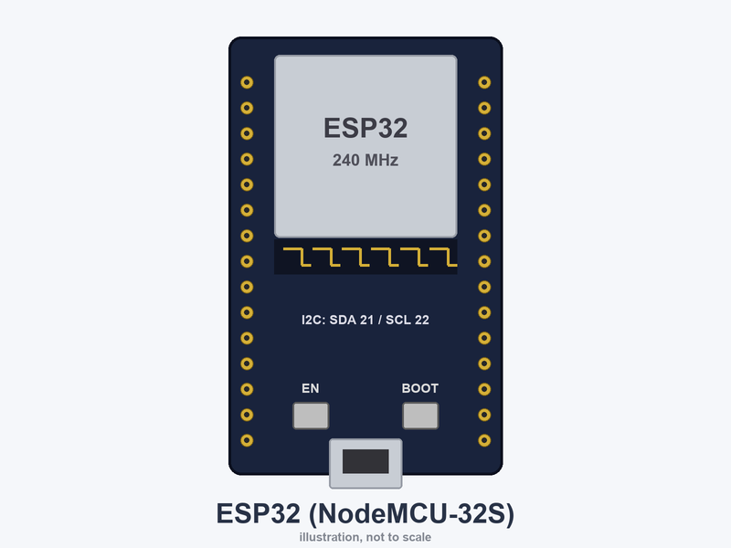</td><td width="320" valign="top">Dual-core 32-bit microcontroller, up to 240 MHz clock, 3.3V logic, I2C compatible (default SDA GPIO21, SCL GPIO22)</td><td width="320" valign="top">Main controller; reads the ToF sensor, both limit switches and the selector, and sends STEP/DIR signals to the stepper driver</td><td width="90" valign="top"></td><td width="80" valign="top"></td><td width="90" valign="top"></td></tr>
<tr><td width="180" valign="top">STEPPER MOTOR NEMA17</td><td width="820" valign="top">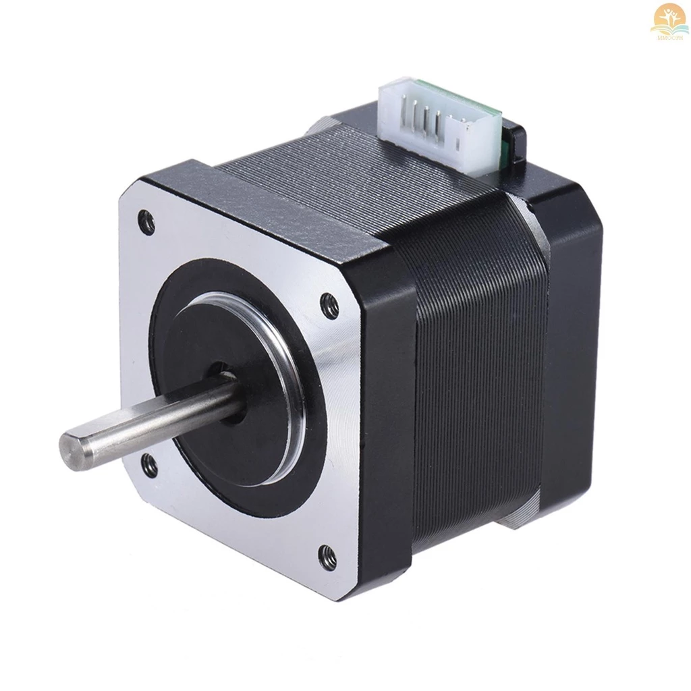</td><td width="320" valign="top">Bipolar stepper motor, 1.8 deg/step (200 steps/rev), 42 x 42 mm frame, 12V class</td><td width="320" valign="top">Turns the lead screw to move the metering slide between its two ends</td><td width="90" valign="top"></td><td width="80" valign="top"></td><td width="90" valign="top"></td></tr>
<tr><td width="180" valign="top">LEAD SCREW T8</td><td width="820" valign="top">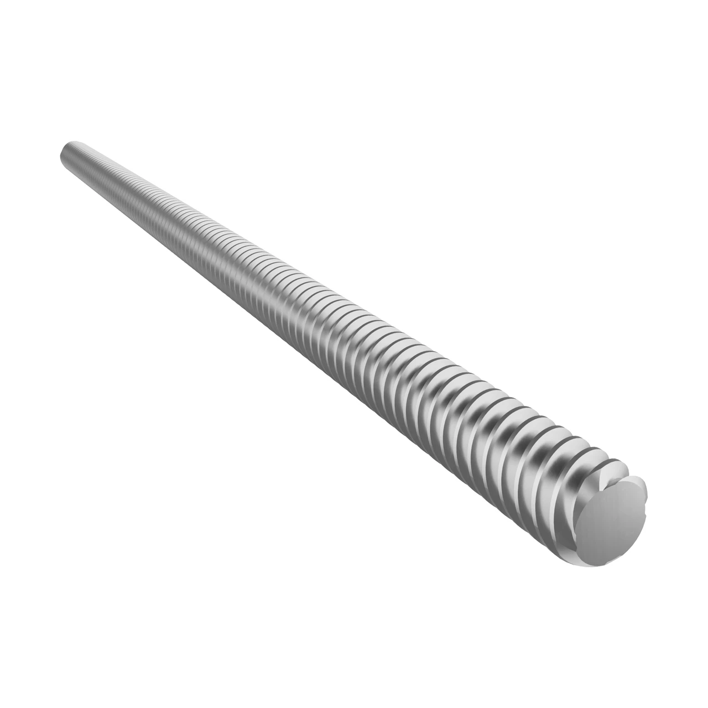</td><td width="320" valign="top">8 mm trapezoidal threaded rod (typically 2 mm pitch, 8 mm lead)</td><td width="320" valign="top">Converts stepper rotation into linear travel of the metering slide</td><td width="90" valign="top"></td><td width="80" valign="top"></td><td width="90" valign="top"></td></tr>
<tr><td width="180" valign="top">TRAVELLING NUT T8</td><td width="820" valign="top">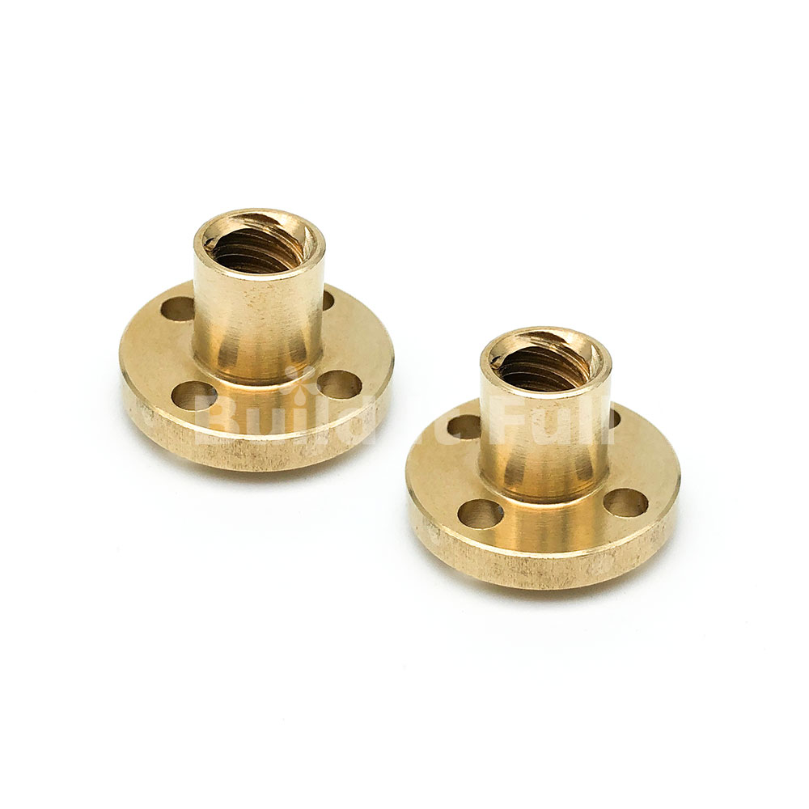</td><td width="320" valign="top">Brass T8 nut matching the lead screw, flange mount</td><td width="320" valign="top">Rides on the lead screw and moves the two-cup metering slide from one end to the other</td><td width="90" valign="top"></td><td width="80" valign="top"></td><td width="90" valign="top"></td></tr>
<tr><td width="180" valign="top">PROTOBOARD</td><td width="820" valign="top">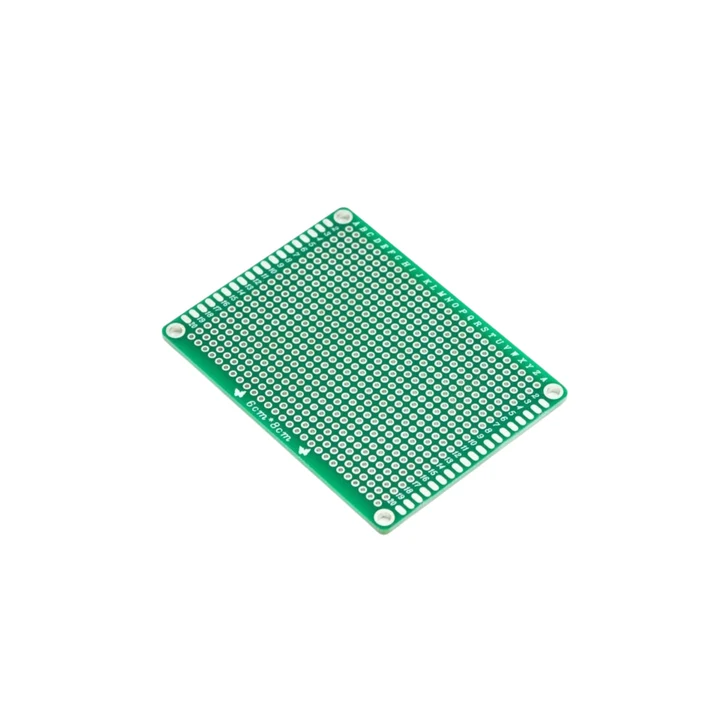</td><td width="320" valign="top">Perforated prototyping PCB with solderable pads</td><td width="320" valign="top">Mounts and wires the ESP32, DRV8825, sensor, switch and power connections</td><td width="90" valign="top"></td><td width="80" valign="top"></td><td width="90" valign="top"></td></tr>
<tr><td width="180" valign="top">DRV8825 STEPPER MOTOR DRIVER</td><td width="820" valign="top">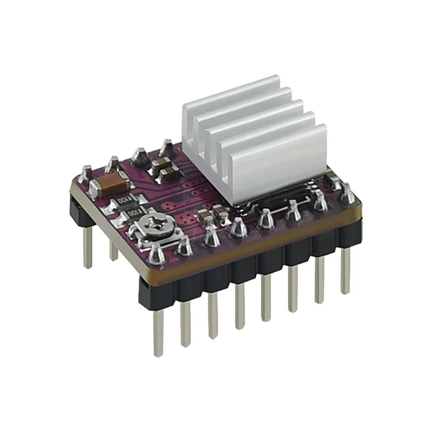</td><td width="320" valign="top">Microstepping driver, 8.2-45V supply, 1.5A per coil without heatsink (2.2A with cooling), STEP/DIR input, up to 1/32 microstepping, adjustable current limit</td><td width="320" valign="top">Drives the NEMA17 from the 12V battery pack under ESP32 control</td><td width="90" valign="top"></td><td width="80" valign="top"></td><td width="90" valign="top"></td></tr>
<tr><td width="180" valign="top">LIFEPO4 33140 CYLINDRICAL BATTERY</td><td width="820" valign="top">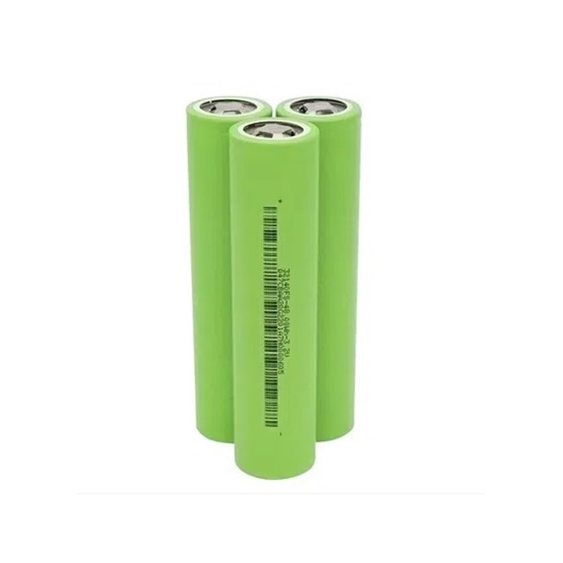</td><td width="320" valign="top">3.2V nominal cylindrical LiFePO4 cell, 33 x 140 mm, approx. 15Ah</td><td width="320" valign="top">Four cells in series (4S) form the 12.8V pack that powers the motor and electronics</td><td width="90" valign="top"></td><td width="80" valign="top"></td><td width="90" valign="top"></td></tr>
<tr><td width="180" valign="top">LIFEPO4 BATTERY MANAGEMENT SYSTEM 4S20A</td><td width="820" valign="top">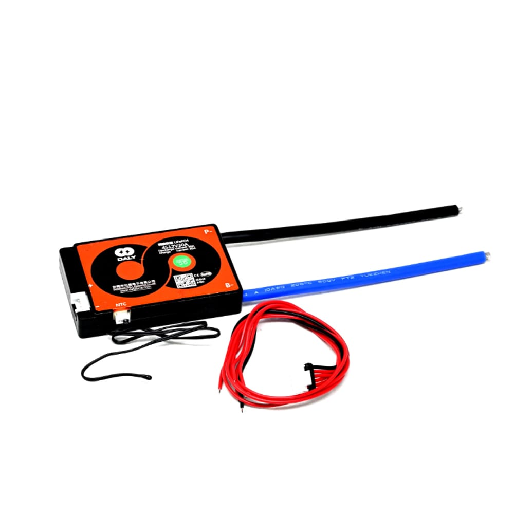</td><td width="320" valign="top">Protection board for 4-cell LiFePO4 packs, 20A continuous; overcharge, over-discharge, overcurrent, short-circuit protection and cell balancing</td><td width="320" valign="top">Protects and balances the battery pack during charging and discharging</td><td width="90" valign="top"></td><td width="80" valign="top"></td><td width="90" valign="top"></td></tr>
<tr><td width="180" valign="top">4S 5A ACTIVE BALANCER</td><td width="820" valign="top">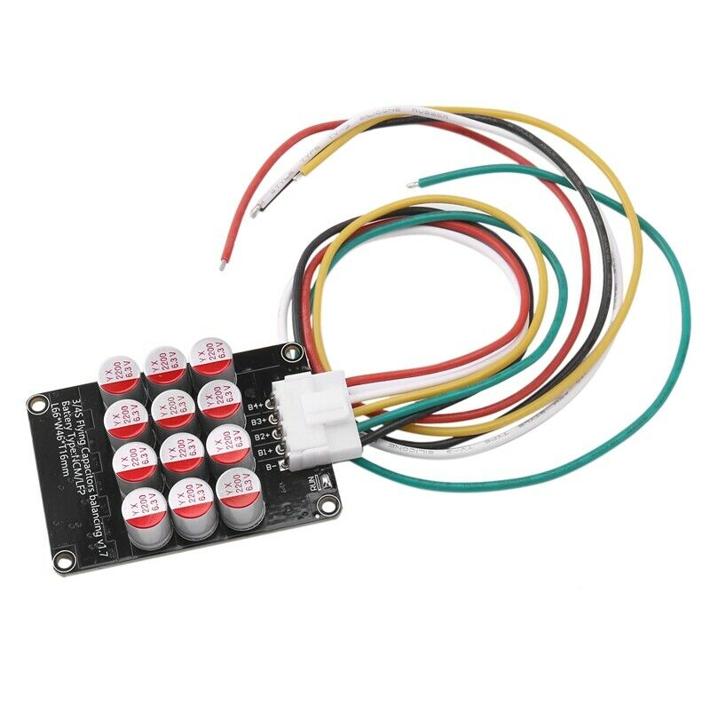</td><td width="320" valign="top">Active cell balancer for 4-cell LiFePO4 packs, up to 5A balancing current, moves charge from higher-voltage cells to lower-voltage cells, 5-wire balance lead (B-, B1, B2, B3, B+)</td><td width="320" valign="top">Keeps the four 33140 cells at equal voltage during charging and discharging, working alongside the BMS</td><td width="90" valign="top"></td><td width="80" valign="top"></td><td width="90" valign="top"></td></tr>
<tr><td width="180" valign="top">LIFEPO4 CHARGER 12V2A (14.6V)</td><td width="820" valign="top">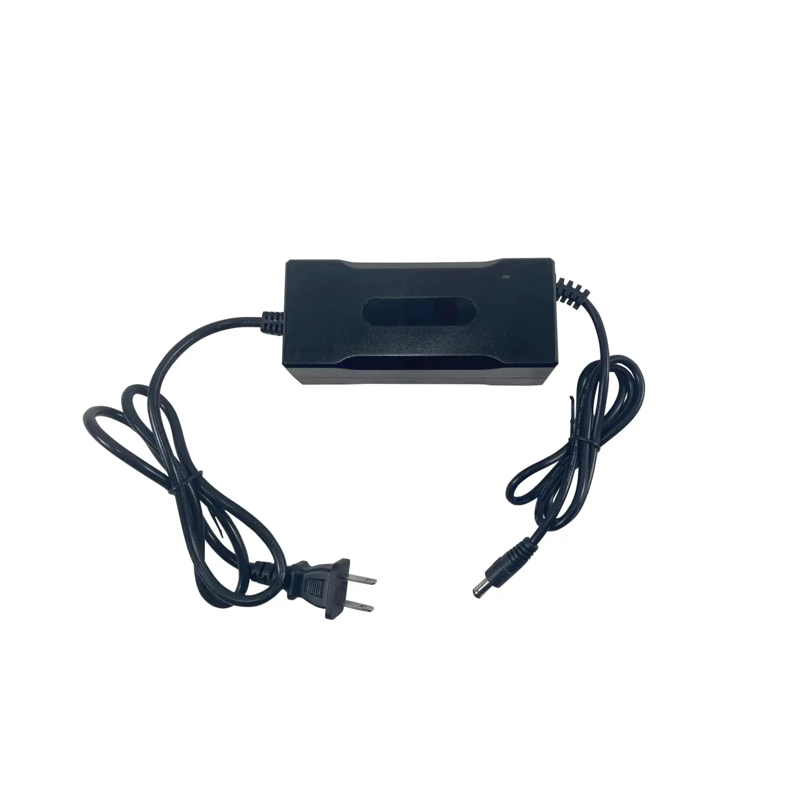</td><td width="320" valign="top">4S LiFePO4 charger, 14.6V full-charge output, 2A maximum</td><td width="320" valign="top">Recharges the 4S battery pack through the BMS</td><td width="90" valign="top"></td><td width="80" valign="top"></td><td width="90" valign="top"></td></tr>
<tr><td width="180" valign="top">SELECTOR SWITCH 3 POSITION</td><td width="820" valign="top">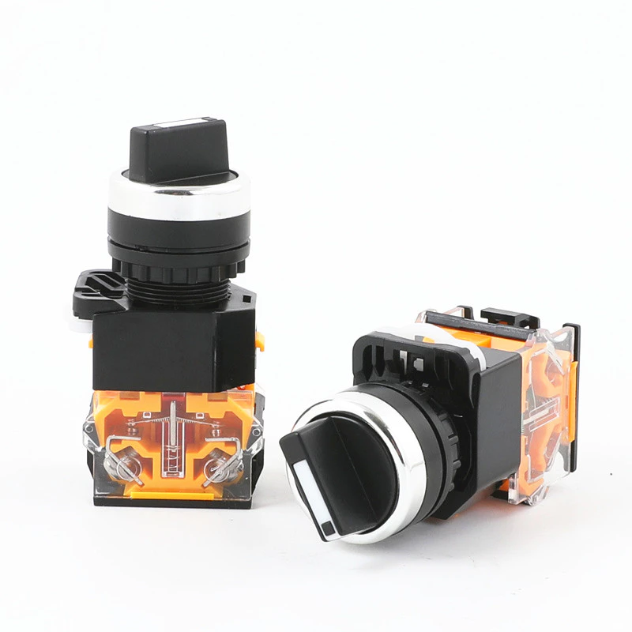</td><td width="320" valign="top">Panel-mount switch with three positions</td><td width="320" valign="top">Selects one of three distance settings; the metering slide is triggered when the ToF reading is less than the selected setting</td><td width="90" valign="top"></td><td width="80" valign="top"></td><td width="90" valign="top"></td></tr>
<tr><td width="180" valign="top">KNAPSACK SPRAYER BODY</td><td width="820" valign="top">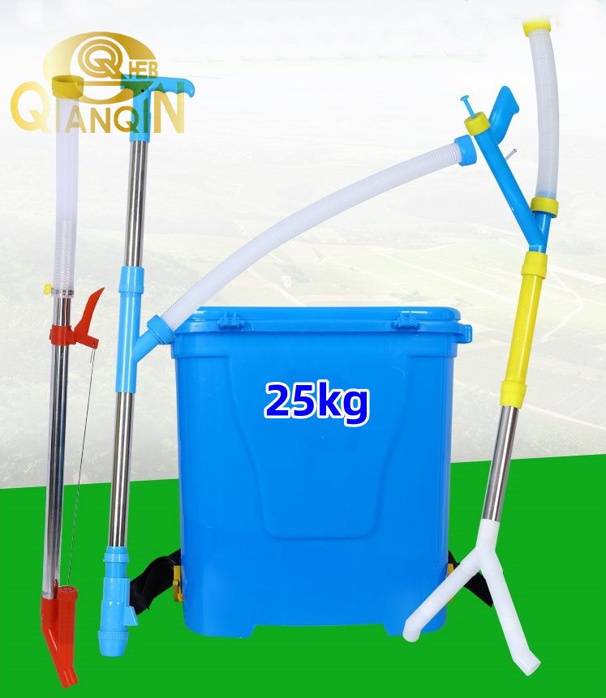</td><td width="320" valign="top">Backpack-carried manual sprayer with tank, straps and lance</td><td width="320" valign="top">Base platform that carries the applicator and electronics</td><td width="90" valign="top"></td><td width="80" valign="top"></td><td width="90" valign="top"></td></tr>
<tr><td width="180" valign="top">PLA+ 3D PRINTER FILAMENT</td><td width="820" valign="top">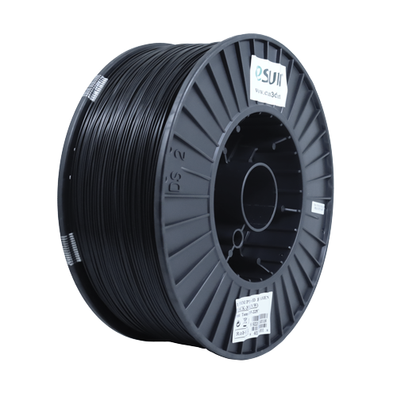</td><td width="320" valign="top">Impact-resistant PLA variant, 1.75 mm, printed at about 200-220 C</td><td width="320" valign="top">Material for the printed brackets, motor mount, enclosure, metering slide and the three replaceable metering cups</td><td width="90" valign="top"></td><td width="80" valign="top"></td><td width="90" valign="top"></td></tr>
<tr><td width="180" valign="top">M4 THREADED NUT INSERTS</td><td width="820" valign="top">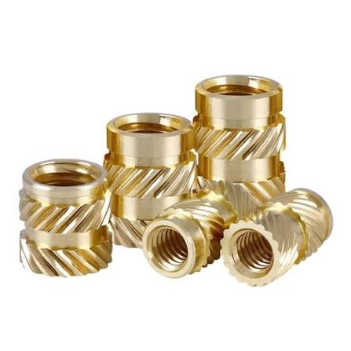</td><td width="320" valign="top">M4 brass heat-set threaded inserts for plastic parts</td><td width="320" valign="top">Durable M4 threads in the printed parts for mounting and assembly</td><td width="90" valign="top"></td><td width="80" valign="top"></td><td width="90" valign="top"></td></tr>
<tr><td width="180" valign="top">M3 TH</td><td width="820" valign="top">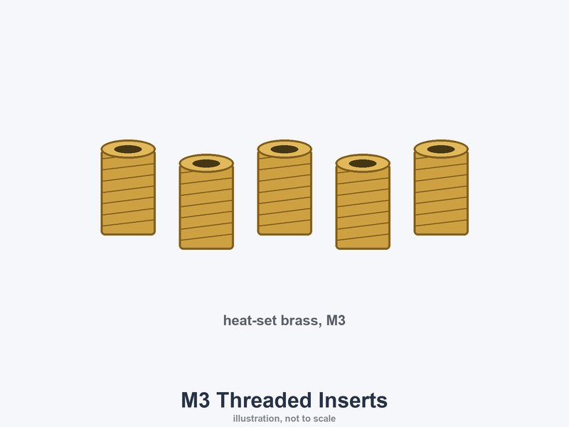</td><td width="320" valign="top">M3 threaded inserts/hardware (to be confirmed)</td><td width="320" valign="top">M3 threads in printed parts for securing the motor, sensor and board</td><td width="90" valign="top"></td><td width="80" valign="top"></td><td width="90" valign="top"></td></tr>
<tr><td width="180" valign="top">VL53L0X ToF RANGE SENSOR</td><td width="820" valign="top">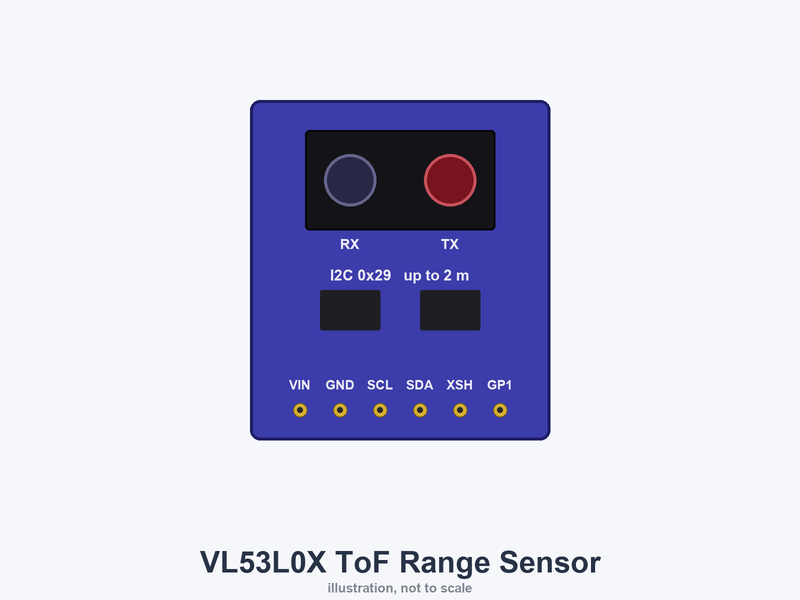</td><td width="320" valign="top">Time-of-flight laser distance sensor, up to about 2 m, I2C (default address 0x29), 2.8-5V supply</td><td width="320" valign="top">Measures distance, compared against the selected distance setting to trigger a metering cycle; read by the ESP32 over I2C</td><td width="90" valign="top"></td><td width="80" valign="top"></td><td width="90" valign="top"></td></tr>
<tr><td width="180" valign="top">LIMIT SWITCH</td><td width="820" valign="top">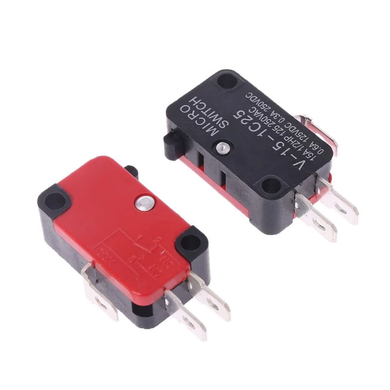</td><td width="320" valign="top">Mechanical lever/roller micro switch</td><td width="320" valign="top">Two units, one at each end of the metering slide travel; they mark the end positions for homing, stopping the slide and over-travel protection</td><td width="90" valign="top"></td><td width="80" valign="top">2</td><td width="90" valign="top"></td></tr>
<tr><td width="180" valign="top"><b>TOTAL</b></td><td width="820" valign="top"></td><td width="320" valign="top"></td><td width="320" valign="top"></td><td width="90" valign="top"></td><td width="80" valign="top"></td><td width="90" valign="top"></td></tr>
</table>

## STEP-BY-STEP MAKING PROCESS

1. **3D printing:** print the brackets, motor mount, enclosure, two-cup metering slide and the three metering cup sizes in PLA+.
2. **Inserts:** install the M4 and M3 threaded inserts into the printed parts.
3. **Lead screw assembly:** couple the T8 lead screw to the NEMA17 shaft and mount the travelling nut on the metering slide.
4. **Limit switches:** mount one limit switch at each end of the metering slide travel.
5. **Battery pack:** connect the four LiFePO4 cells in series through the 4S20A BMS, connect the 4S 5A active balancer to the five cell tap points (B-, B1, B2, B3, B+), and connect the charger to the charge input.
6. **Electronics:** solder the ESP32, DRV8825, VL53L0X and selector switch connections on the protoboard.
7. **Mounting:** fix the mechanism, battery pack and electronics to the knapsack sprayer body.
8. **Driver setup:** set the DRV8825 current limit for the motor before first power-up.
9. **Code and testing:** develop the code, upload it, and test homing, slide travel and each distance setting with each cup size before field use.

## ALGORITHM

Planned logic (draft, to be confirmed against the final firmware):

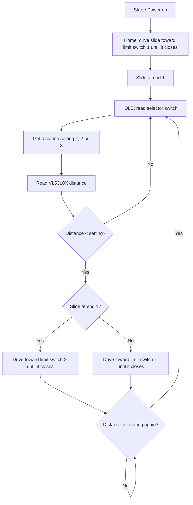

1. On boot the driver is enabled and the slide is driven toward limit switch 1 until it closes, which defines end 1.
2. In `IDLE`, the selector switch position is read to get the distance setting (1, 2 or 3).
3. The VL53L0X distance is read and compared with the selected setting.
4. If the distance is less than the setting, the stepper drives the slide from its current end toward the opposite limit switch and stops when that switch closes. One cup discharges while the other cup loads.
5. If a limit switch closes unexpectedly, or the opposite switch is not reached within a timeout, the motor is stopped (over-travel protection).
6. The system waits until the distance is back at or above the setting before it can trigger again, so one detection gives one dose.
7. The dose size depends on the installed metering cup (three replaceable sizes).

## CODE EXPLANATION

The firmware is in [src/main.cpp](src/main.cpp) (PlatformIO, Arduino framework, ESP32 NodeMCU-32S, 115200 baud serial monitor). It currently defines the pin macros and the ToF sensor address; the logic is not yet written.

### Pins

| Macro | Pin | Connected to |
| --- | --- | --- |
| `SELECTOR_PIN_1` | GPIO25 | Selector switch position 1 (`INPUT_PULLUP`) |
| `SELECTOR_PIN_2` | GPIO26 | Selector switch position 2 (`INPUT_PULLUP`) |
| `STEPPER_DIR_PIN` | GPIO27 | DRV8825 `DIR` |
| `STEPPER_STEP_PIN` | GPIO14 | DRV8825 `STEP` |
| `STEPPER_ENABLE_PIN` | GPIO12 | DRV8825 `EN` |
| (I2C `SDA`) | GPIO21 | VL53L0X `SDA` |
| (I2C `SCL`) | GPIO22 | VL53L0X `SCL` |
| `LIMIT_SWITCH_PIN_1` | GPIO32 | Limit switch 1, end 1 (`INPUT_PULLUP`, other side to GND) |
| `LIMIT_SWITCH_PIN_2` | GPIO33 | Limit switch 2, end 2 (`INPUT_PULLUP`, other side to GND) |

`TOF_SENSOR_I2C_ADDRESS` is `0x29`.

The selector common goes to GND. Pin 1 low is setting 1, pin 2 low is setting 2, and both high (middle position) is setting 3.

## CIRCUIT DIAGRAM

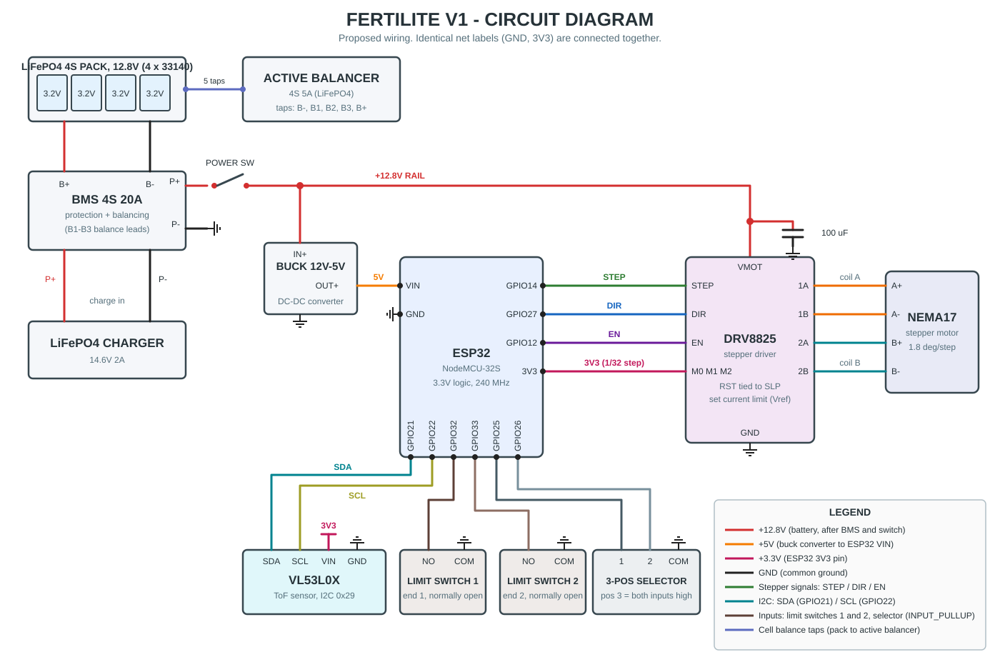

### Wiring (proposed)

| No. | From | From Pin | To | To Pin | Signal | Wire Color (diagram) |
| --- | --- | --- | --- | --- | --- | --- |
| 1 | LiFePO4 pack (4S) | `+` | BMS | `B+` | Pack positive | Red |
| 2 | LiFePO4 pack (4S) | `-` | BMS | `B-` | Pack negative | Black |
| 3 | LiFePO4 pack (4S) | Cell junctions | BMS | `B1`, `B2`, `B3` | Cell balance leads | - |
| 4 | LiFePO4 pack (4S) | `-` (cell 1 negative) | Active balancer | `B-` | Balance tap 0 | Indigo |
| 5 | LiFePO4 pack (4S) | Cell 1/2 junction | Active balancer | `B1` | Balance tap 1 | Indigo |
| 6 | LiFePO4 pack (4S) | Cell 2/3 junction | Active balancer | `B2` | Balance tap 2 | Indigo |
| 7 | LiFePO4 pack (4S) | Cell 3/4 junction | Active balancer | `B3` | Balance tap 3 | Indigo |
| 8 | LiFePO4 pack (4S) | `+` (cell 4 positive) | Active balancer | `B+` | Balance tap 4 | Indigo |
| 9 | Charger | `+` | BMS | `P+` | Charge input positive (14.6V) | Red |
| 10 | Charger | `-` | BMS | `P-` | Charge input negative | Black |
| 11 | BMS | `P+` | Power switch | In | +12.8V | Red |
| 12 | Power switch | Out | DRV8825 | `VMOT` | +12.8V motor supply | Red |
| 13 | Power switch | Out | Buck converter | `IN+` | +12.8V | Red |
| 14 | BMS | `P-` | Buck converter | `GND` | Ground | Black |
| 15 | BMS | `P-` | DRV8825 | `GND` (motor) | Ground | Black |
| 16 | Buck converter | `OUT+` | ESP32 | `VIN` | +5V | Orange |
| 17 | Buck converter | `GND` | ESP32 | `GND` | Ground | Black |
| 18 | 100 uF capacitor | `+` | DRV8825 | `VMOT` | Motor supply decoupling | Red |
| 19 | 100 uF capacitor | `-` | DRV8825 | `GND` | Motor supply decoupling | Black |
| 20 | ESP32 | `3V3` | VL53L0X | `VIN` | +3.3V | Pink |
| 21 | ESP32 | `3V3` | DRV8825 | `M0`, `M1`, `M2` | 1/32 microstepping | Pink |
| 22 | ESP32 | `GND` | DRV8825 | `GND` (logic) | Ground | Black |
| 23 | ESP32 | `GND` | VL53L0X | `GND` | Ground | Black |
| 24 | DRV8825 | `RST` | DRV8825 | `SLP` | Jumper (driver enabled) | - |
| 25 | ESP32 | `GPIO14` | DRV8825 | `STEP` | Step pulse | Green |
| 26 | ESP32 | `GPIO27` | DRV8825 | `DIR` | Direction | Blue |
| 27 | ESP32 | `GPIO12` | DRV8825 | `EN` | Enable | Purple |
| 28 | DRV8825 | `1A` | NEMA17 | `A+` | Coil A | Orange |
| 29 | DRV8825 | `1B` | NEMA17 | `A-` | Coil A | Orange |
| 30 | DRV8825 | `2A` | NEMA17 | `B+` | Coil B | Teal |
| 31 | DRV8825 | `2B` | NEMA17 | `B-` | Coil B | Teal |
| 32 | ESP32 | `GPIO21` | VL53L0X | `SDA` | I2C data | Teal |
| 33 | ESP32 | `GPIO22` | VL53L0X | `SCL` | I2C clock | Olive |
| 34 | ESP32 | `GPIO32` | Limit switch 1 | `NO` | End 1 detect (`INPUT_PULLUP`) | Brown |
| 35 | Limit switch 1 | `COM` | ESP32 | `GND` | Ground | Black |
| 36 | ESP32 | `GPIO33` | Limit switch 2 | `NO` | End 2 detect (`INPUT_PULLUP`) | Brown |
| 37 | Limit switch 2 | `COM` | ESP32 | `GND` | Ground | Black |
| 38 | ESP32 | `GPIO25` | Selector switch | Position 1 | Distance setting 1 (`INPUT_PULLUP`) | Gray |
| 39 | ESP32 | `GPIO26` | Selector switch | Position 2 | Distance setting 2 (`INPUT_PULLUP`) | Gray |
| 40 | Selector switch | `COM` | ESP32 | `GND` | Ground (position 3 = both inputs high) | Black |
